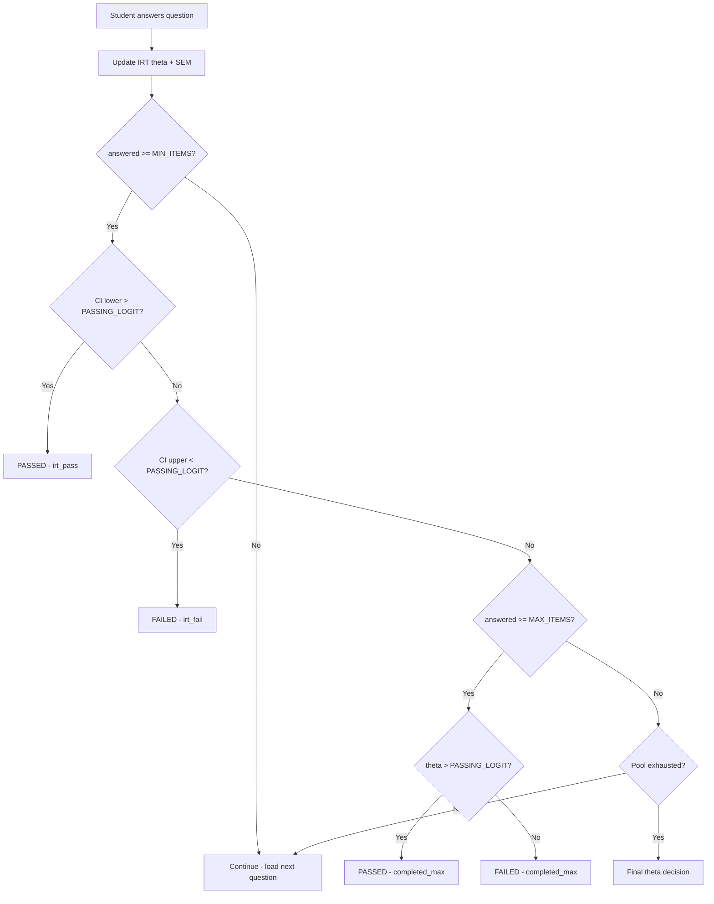

# May 16 — Full Deep-Planning Architecture Document

> **Status**: Planning Only — No Implementation  
> **Author**: Senior Architecture Team (SaaS Architect + UI/UX + System Analyst + PHP/MySQL Engineer)  
> **Date**: 2026-05-16  
> **Scope**: 14 sections covering result logic, CAT engine, UI redesign, UX flows, and architecture cleanup

---

## Table of Contents

1. [Failed Result Logic (CPR)](#section-1--failed-result-logic-cpr)
2. [CAT Exam Stopping Logic Bug](#section-2--cat-exam-stopping-logic-bug)
3. [Sidebar UI Redesign](#section-3--sidebar-ui-redesign)
4. [Remove Sticky Footer](#section-4--remove-sticky-footer)
5. [topic.php UX Redesign](#section-5--topicphp-ux-redesign)
6. [Preloader Redesign](#section-6--preloader-redesign)
7. [Restore Question Tools](#section-7--restore-question-tools)
8. [Restore Question Navigator](#section-8--restore-question-navigator)
9. [Timer Logic Fix](#section-9--timer-logic-fix)
10. [SATA Question Type Restore](#section-10--sata-question-type-restore)
11. [Typography + Font System](#section-11--typography--font-system-redesign)
12. [First Login Tutorial](#section-12--first-login-interactive-tutorial)
13. [Master Architecture Analysis](#section-13--master-architecture-analysis)
14. [Output Requirements](#section-14--output-requirements)

---

# SECTION 1 — Failed Result Logic (CPR)

## 1.1 Goal

Replace the generic statistics display on the FAILED result page (`student/dashboard/exam/result.php`) with an NCSBN-compliant **Candidate Performance Report (CPR)** that shows topic-level performance breakdowns with "Below / Near / Above Passing Standard" classifications. The CPR must be **concept-aware** — meaning it must only display topics from the concepts the student actually selected for that exam attempt.

## 1.2 Current Issue — Deep Analysis

### Current CAT Exam Result Page (`exam/result.php`)

The current implementation at [exam/result.php](file:///c:/xampp/htdocs/studium-cat/student/dashboard/exam/result.php) has a CPR section (lines 83–103) that:

1. **Queries by `cnc` (Client Needs Category)** — groups results by the `cnc` column from `exammoderesults`:
   ```sql
   SELECT cnc, SUM(earned_points) AS total_earned, SUM(max_points) AS total_max
   FROM exammoderesults WHERE student_id = ? AND examTaken = ?
   AND cnc IS NOT NULL AND cnc <> '' GROUP BY cnc
   ```
2. **Uses ratio thresholds**: `≥0.65` = Above, `≥0.35` = Near, `<0.35` = Below
3. **Does NOT filter by selected concepts** — it shows ALL `cnc` values regardless of what the student originally chose
4. **Does NOT show topic-level granularity** — only shows `cnc` (e.g., "Safe and Effective Care Environment")
5. **Has NO progress bars** — only badge pills

### Current Traditional Result Page (`student/dashboard/result.php`)

The traditional result page at [result.php](file:///c:/xampp/htdocs/studium-cat/student/dashboard/result.php) shows:
- Pass/fail banner based on 75% threshold
- Correct/Wrong/Score/Time stats
- Pie chart + progress bar
- Question review table with system breakdown
- **No CPR** — just raw scores

### Data Flow Gap

The exam pool is built in `exam/index.php` (lines 26–36) using `$examDistribution` which pulls from tables like `mcq`, `cat`, `sata`, `mmr`, etc. However:
- **Question concept/topic metadata** is stored per-question in each table (`topic`, `system`, `cnc`, `dlevel` columns)
- The `exammoderesults` table stores `topic`, `system`, `cnc` per answered question
- **BUT** — no record of which concepts the student originally selected is saved to the database

> [!CAUTION]
> The CAT exam mode (`exam/index.php`) currently does **NOT** have a concept selection step — it pulls from ALL tables. The concept filter only exists in the NGN exam flow (`ngn/index.php` lines 120–123). This means the "selected concepts" requirement needs a **new feature** added to the CAT exam pre-start flow.

## 1.3 Expected Behavior

### CASE 1: Single Concept Selected

If student selected only **one concept** (e.g., "Cardiovascular"):

```
┌─────────────────────────────────────────────────┐
│  CANDIDATE PERFORMANCE REPORT                    │
│  Concept: Cardiovascular                         │
├─────────────────────────────────────────────────┤
│                                                   │
│  Heart Failure          ████████░░  Above Passing │
│  Hypertension           ██████░░░░  Near Passing  │
│  ECG Interpretation     ███░░░░░░░  Below Passing │
│  MI / ACS               █████████░  Above Passing │
│  Valve Disorders         ████░░░░░  Near Passing  │
│                                                   │
└─────────────────────────────────────────────────┘
```

- Only topics **under the selected concept** appear
- Topics with zero questions attempted should show "Not Assessed" in muted gray
- Progress bars represent earned/max ratio per topic

### CASE 2: Multiple Concepts Selected

If student selected 2+ concepts (e.g., "Cardiovascular", "OB", "Pharma"):

```
┌─────────────────────────────────────────────────┐
│  CANDIDATE PERFORMANCE REPORT                    │
│  Concepts: Cardiovascular · OB · Pharmacology    │
├─────────────────────────────────────────────────┤
│                                                   │
│  ── Cardiovascular ──                             │
│  Heart Failure          ████████░░  Above Passing │
│  Hypertension           ██████░░░░  Near Passing  │
│                                                   │
│  ── Obstetrics ──                                 │
│  Antepartum             ███░░░░░░░  Below Passing │
│  Intrapartum            █████████░  Above Passing │
│                                                   │
│  ── Pharmacology ──                               │
│  Cardiac Meds           ████████░░  Above Passing │
│  Psych Meds             ██░░░░░░░░  Below Passing │
│                                                   │
└─────────────────────────────────────────────────┘
```

- Topics grouped by concept with visual section headers
- Each topic has its own progress bar and classification badge
- Combined view across all selected concepts

## 1.4 Technical Flow

### Step 1: Store Selected Concepts at Exam Start

**File**: `exam/index.php`

Add a concept selection step to the pre-exam modal (currently only has mode selection + rules). This requires:

1. **New UI step** between mode selection and rules: "Select Concepts" with checkboxes
2. **Store selection** in session AND database:
   ```php
   // In exam start JS → POST to a new endpoint or include in state_manager
   $_SESSION['exam_selected_concepts'] = ['Cardiovascular', 'OB'];
   ```
3. **New DB column** on `exammoderesults` terminal row OR a new table:
   ```sql
   ALTER TABLE exammoderesults ADD COLUMN selected_concepts JSON DEFAULT NULL;
   ```
   Only the terminal row (where `is_terminal = 1`) stores this.

### Step 2: Filter Pool by Selected Concepts

**File**: `exam/index.php` (pool building section, lines 45–75)

Currently the pool queries use `ORDER BY RAND()` with no concept filter. Add:

```php
// If concepts were selected, add WHERE clause
if (!empty($conceptFilter)) {
    $ph = implode(',', array_fill(0, count($conceptFilter), '?'));
    $where .= " AND topic IN ({$ph})";
    // OR: AND concept IN ({$ph}) — depends on column naming
}
```

### Step 3: Build CPR Data on Result Page

**File**: `exam/result.php`

```php
// Fetch selected concepts from terminal row
$terminal = db()->fetchOne("SELECT selected_concepts FROM exammoderesults WHERE ...");
$selectedConcepts = json_decode($terminal['selected_concepts'], true) ?: [];

// Fetch per-topic performance
$cprTopics = db()->fetchAll(
    "SELECT topic, system, cnc,
            SUM(earned_points) AS earned,
            SUM(max_points) AS max_possible,
            COUNT(*) AS items_attempted
     FROM exammoderesults
     WHERE student_id = ? AND examTaken = ?
       AND topic IS NOT NULL AND topic <> ''
     GROUP BY topic
     ORDER BY topic ASC",
    [$student_id, $examTaken]
);

// Group by concept (concept → topic mapping from a lookup table or the `system` column)
$grouped = [];
foreach ($cprTopics as $row) {
    $concept = $row['system'] ?: 'General'; // system = concept in this schema
    $grouped[$concept][] = $row;
}

// Filter: only show concepts student selected
if (!empty($selectedConcepts)) {
    $grouped = array_intersect_key($grouped, array_flip($selectedConcepts));
}
```

### Step 4: Classification Thresholds

```php
function classifyPerformance(float $ratio): array {
    if ($ratio >= 0.65) return ['label' => 'Above Passing Standard', 'class' => 'above', 'color' => '#10b981'];
    if ($ratio >= 0.35) return ['label' => 'Near Passing Standard',  'class' => 'near',  'color' => '#f59e0b'];
    return                     ['label' => 'Below Passing Standard', 'class' => 'below', 'color' => '#ef4444'];
}
```

## 1.5 UI/UX Behavior

### Visual Design Spec

```
HEADER BAR
├── Full-width dark gradient bar (#450a0a → #991b1b)
├── "❌ FAILED" large text
├── "You have not passed the NCLEX examination at this time."
└── Items Answered / Exam Duration stat cards below

CPR SECTION (white card, rounded corners)
├── Section title: "📊 Candidate Performance Report"
├── Description text explaining the report
├── Concept header (if multiple concepts)
│   └── Gray separator line + concept name in bold
├── For each topic:
│   ├── Topic name (left-aligned, font-weight: 600)
│   ├── Progress bar (colored by classification)
│   │   ├── Above: green gradient (#10b981 → #059669)
│   │   ├── Near: amber gradient (#f59e0b → #d97706)
│   │   └── Below: red gradient (#ef4444 → #dc2626)
│   ├── Percentage label (right of bar)
│   └── Classification badge (pill shape)
└── "Not Assessed" row for topics with 0 items (muted, dashed border)
```

### Animation

- Progress bars animate from 0% to actual width on page load (CSS transition, 0.8s ease-out, staggered by 100ms per row)
- Section cards fade in with slight translateY(10px → 0) animation

### Color State Mapping

| Ratio | Label | Bar Color | Badge BG | Badge Text |
|-------|-------|-----------|----------|------------|
| ≥ 0.65 | Above Passing Standard | `#10b981` | `#dcfce7` | `#166534` |
| ≥ 0.35 | Near Passing Standard | `#f59e0b` | `#fef3c7` | `#92400e` |
| < 0.35 | Below Passing Standard | `#ef4444` | `#fee2e2` | `#991b1b` |
| 0 items | Not Assessed | `#e2e8f0` | `#f1f5f9` | `#94a3b8` |

## 1.6 Backend Logic — Topic Grouping & Averaging

### Topic-to-Concept Mapping

The `exammoderesults` table stores:
- `topic` — specific subject (e.g., "Heart Failure")
- `system` — broader category (e.g., "Cardiovascular")  
- `cnc` — Client Needs Category (e.g., "Physiological Integrity")

For CPR grouping:
- **Single concept**: Group by `topic`, filter by `system = selectedConcept`
- **Multiple concepts**: Group by `system` → `topic` hierarchy

### Performance Averaging

Per-topic ratio = `SUM(earned_points) / SUM(max_points)` across all items in that topic for this exam attempt.

**Edge case**: If `max_points` is 0 for all items (shouldn't happen, but defensively):
```php
$ratio = $max > 0 ? $earned / $max : 0.0;
```

### Empty Topic Handling

Topics with 0 attempted questions should still appear if they belong to a selected concept. This requires a **concept-topic lookup table** or hardcoded mapping:

```php
$conceptTopicMap = [
    'Cardiovascular' => ['Heart Failure', 'Hypertension', 'ECG', 'MI/ACS', 'Valve Disorders'],
    'Pharmacology'   => ['Cardiac Meds', 'Psych Meds', 'Pain Meds', 'Drug Calculations'],
    // ... etc
];
```

## 1.7 Edge Cases

| Edge Case | Handling |
|-----------|----------|
| Student has 0 answered questions for a topic | Show "Not Assessed" with muted styling |
| `cnc`, `topic`, or `system` is NULL | Skip from CPR; show "Content area data not available" fallback |
| Student passed (not failed) | CPR section is hidden entirely (NCSBN policy) |
| Only 1 question in a topic | Still show — ratio = earned/max for that 1 item |
| No concepts were selected (legacy exam) | Show ALL topics as ungrouped flat list |
| `selected_concepts` JSON is corrupted | Fall back to showing all topics ungrouped |
| Exam was time-expired with < MIN_ITEMS | Still show CPR for whatever was answered |

## 1.8 Database / Query Impact

### New Column
```sql
ALTER TABLE exammoderesults ADD COLUMN selected_concepts JSON DEFAULT NULL;
```
Only written on the terminal row. Index not needed (queried by PK).

### New Lookup Table (Optional)
```sql
CREATE TABLE concept_topic_map (
    concept VARCHAR(100) NOT NULL,
    topic VARCHAR(100) NOT NULL,
    PRIMARY KEY (concept, topic)
);
```
Pre-populated from question bank metadata. Used to display "Not Assessed" topics.

### Query Performance
- CPR query adds 1 additional `GROUP BY topic` query per result page load
- Estimated: <5ms on indexed `(student_id, examTaken)` compound key
- No impact on exam-time performance

## 1.9 Performance Impact

- **Page load**: +1 SQL query (~5ms), +~2KB HTML for CPR section
- **No JS overhead**: Progress bar animations are pure CSS
- **Caching**: Result page is already `no-cache`; no change needed

## 1.10 Mobile Responsiveness

- Progress bars stack vertically on `< 480px`
- Badge pills shift below topic name instead of inline
- Concept headers become full-width dividers
- Font sizes reduce via `clamp()`: topic name `clamp(0.78rem, 2vw, 0.88rem)`

## 1.11 Accessibility for Non-Techy Users

- Traffic light colors (green/amber/red) are universally understood
- Labels are in plain English: "Above Passing Standard" not "≥ 0.65 ratio"
- Progress bars have `aria-valuenow`, `aria-valuemin`, `aria-valuemax` attributes
- Each topic row has `role="listitem"` for screen readers
- Tooltip on hover explains: "You answered X out of Y questions correctly in this topic"

## 1.12 Risks

| Risk | Severity | Mitigation |
|------|----------|------------|
| `topic` column is NULL/empty for many questions | High | Fallback to `system` or `cnc` for grouping |
| Concept selection adds friction to exam start | Medium | Make it optional — default = "All Concepts" |
| Mapping table gets stale as questions are added | Medium | Auto-populate from `DISTINCT topic, system` in question tables |
| Legacy exams (no `selected_concepts`) break | Low | Null-coalesce to show all topics |

## 1.13 Suggested Implementation Structure

```
Phase 1: Database migration
  ├── Add selected_concepts column to exammoderesults
  └── Create concept_topic_map lookup table

Phase 2: Exam start flow
  ├── Add concept selection step to exam/index.php pre-exam modal
  ├── Store selected concepts in session + terminal row
  └── Filter pool by selected concepts

Phase 3: Result page CPR
  ├── Build topic grouping query in exam/result.php
  ├── Create CPR HTML/CSS component with progress bars
  ├── Add classification logic
  └── Handle edge cases (empty topics, legacy exams)

Phase 4: Polish
  ├── CSS animations for progress bars
  ├── Mobile responsive layout
  └── Accessibility attributes
```

---

# SECTION 2 — CAT Exam Mode Stopping Logic Bug

## 2.1 Goal

Fix the CAT exam engine so it **correctly terminates early** when:
- The student has **clearly passed** (theta consistently above passing standard)
- The student has **clearly failed** (theta consistently below passing standard, impossible to recover)

Currently, even when a student is performing terribly (e.g., 0% after 20 questions), the exam continues all the way to the maximum item count.

## 2.2 Current Issue — Deep Analysis

### Current Stopping Logic

Located in `exam/index.php`, function `checkExamTermination()` (lines 968–999):

```javascript
function checkExamTermination() {
    const answered = Object.keys(userAnswers).length;
    if (answered < MIN_ITEMS) return null;  // MIN_ITEMS = 15 (dev) / 85 (prod)
    
    const ciHalf = IRT_CONFIDENCE * irt.sem;  // IRT_CONFIDENCE = 1.96
    const thetaLow  = irt.theta - ciHalf;
    const thetaHigh = irt.theta + ciHalf;
    
    if (thetaLow > PASSING_LOGIT) return { result: 'PASSED', reason: 'irt_pass' };
    if (thetaHigh < PASSING_LOGIT) return { result: 'FAILED', reason: 'irt_fail' };
    
    if (answered >= MAX_ITEMS) {
        return { result: irt.theta > PASSING_LOGIT ? 'PASSED' : 'FAILED', reason: 'completed_max' };
    }
    return null;
}
```

### Why It Doesn't Stop Early — Root Cause

The IRT engine uses **Newton-Raphson MAP estimation** with a `N(0,1)` prior (line 686–704). The SEM calculation (lines 708–712) is:

```javascript
calculateSEM() {
    let info = 1; // prior contribution
    for (const item of this.history) info += this.information(this.theta, item.b);
    return 1.0 / Math.sqrt(info);
}
```

**The problem**: SEM shrinks **very slowly** with a standard normal prior. After 15 items:
- SEM ≈ `1 / √(1 + 15 * 0.25)` = `1 / √4.75` ≈ **0.459**
- CI half = `1.96 × 0.459` ≈ **0.90**

So even with `theta = -2.0` (terrible performance), the 95% CI is `[-2.0 - 0.90, -2.0 + 0.90]` = `[-2.90, -1.10]`. Since `PASSING_LOGIT = 0.0`, the CI upper bound `-1.10 < 0.0`, so it SHOULD trigger `irt_fail`.

**But wait** — `MIN_ITEMS = 15` in dev mode. Let's check if the issue is that `MIN_ITEMS` is set too high for the dev pool size. The dev pool is `TARGET_TOTAL = 30`, and `MIN_ITEMS = 15`. If the student gets everything wrong from Q1-Q15:

After 15 all-wrong answers with items at `b=0.0`:
- Theta converges to approximately `-2.5` to `-3.0`
- SEM ≈ `1/√(16)` = `0.25` (best case with max info items)
- CI = `[-3.0 - 0.49, -3.0 + 0.49]` = `[-3.49, -2.51]`
- Upper bound `-2.51 < 0.0` → **SHOULD trigger irt_fail**

So the stopping logic **should work mathematically**. Let me check for bugs:

### Potential Bug #1: Score Never Reaches 0

The `score` variable in the message handler (line 1246):
```javascript
let score = typeof event.data.score !== 'undefined' ? parseFloat(event.data.score) : (isCorrect ? 1 : 0);
if (score > 1) score = score / 100;
score = Math.max(0, Math.min(1, score));
```

IRT update (line 1273): `irt.updateTheta(score, itemB)` — passes `score` which is partial credit. If a student gets partial credit (e.g., 0.3 on a SATA), the theta doesn't drop as fast.

### Potential Bug #2: Adaptive Selection Reduces Information

The `selectNextItem` method (lines 715–723) picks from top-5 by Fisher Information. Fisher Information is maximized when `theta ≈ b` (item difficulty matches ability). As theta drops to `-2.0`, the available items (mostly `b ≈ 0.0`) have very LOW information at theta=-2.0:

```
I(θ=-2.0, b=0.0) = P * (1-P) = 0.119 * 0.881 = 0.105
```

vs. at theta=0:
```
I(θ=0.0, b=0.0) = 0.25
```

So information per item is HALVED when the student is far from the item pool's difficulty. This means SEM shrinks 2× slower, delaying the CI resolution.

### Potential Bug #3: Dev Pool Too Small

With `TARGET_TOTAL = 30` items and `MIN_ITEMS = 15`, after the minimum is met, there are only 15 more items available. If items have difficulty concentrated around `b=0.0`, a student at `theta=-3.0` accumulates very little information per item, so the CI may never tighten enough.

## 2.3 Expected Behavior

### Normal Mode
```
Q1-Q15:  Minimum items — NO stopping regardless of performance
Q16-Q30: Check IRT 95% CI after EVERY answer
          → If CI entirely above 0.0 → PASSED (irt_pass)
          → If CI entirely below 0.0 → FAILED (irt_fail)
Q30:     Maximum items reached — final theta decision
          → theta > 0.0 → PASSED
          → theta ≤ 0.0 → FAILED
```

### Pressure Mode
Same logic, plus:
- Timeout → auto-skip (omitted, score=0)
- Omitted items still update IRT (score=0)

### Flowchart



## 2.4 Technical Fix

### Fix A: Reduce MIN_ITEMS for Dev Mode

```javascript
const MIN_ITEMS = IS_DEV_MODE ? 10 : 85;  // Was 15, now 10 for faster CI resolution
```

### Fix B: Add Run-Out-The-Clock (ROTC) Rule

NCSBN's actual secondary stopping rule: if after MAX_ITEMS the CI still straddles the passing standard, use the **last 60 items** to make a final ability decision:

```javascript
// After Rule 1 (CI) fails and MAX_ITEMS reached:
if (answered >= MAX_ITEMS) {
    // NCSBN ROTC: use performance on last 60% of items
    const recentCount = Math.ceil(answered * 0.6);
    const recentItems = irt.history.slice(-recentCount);
    const recentCorrect = recentItems.filter(h => h.x >= 0.5).length;
    const recentRatio = recentCorrect / recentCount;
    
    const result = recentRatio >= 0.5 ? 'PASSED' : 'FAILED';
    return { result, reason: 'completed_max_rotc', percent: pct };
}
```

### Fix C: Add Mercy Rule for Extreme Cases

If after 20+ items, theta is so far below passing that even perfect performance on remaining items can't save it:

```javascript
// Mercy rule: if even answering all remaining items correctly can't pass
if (answered >= 20) {
    const remainingItems = MAX_ITEMS - answered;
    // Simulate: if student got all remaining correct, what would theta be?
    let simTheta = irt.theta;
    let simInfo = irt.history.reduce((a, h) => a + irt.information(simTheta, h.b), 1);
    
    // Rough: each correct adds ~0.1-0.3 to theta depending on difficulty
    const maxThetaGain = remainingItems * 0.15; // conservative estimate
    const bestCaseTheta = irt.theta + maxThetaGain;
    
    if (bestCaseTheta < PASSING_LOGIT - 0.5) {
        return { result: 'FAILED', reason: 'mercy_rule', percent: pct };
    }
}
```

## 2.5 Edge Cases

| Edge Case | Handling |
|-----------|----------|
| Student gets Q1-Q10 wrong, then Q11-Q15 right | CI will be wide; continue past MIN_ITEMS |
| All items have same difficulty (b=0) | SEM converges slower; ROTC rule catches it |
| Student's theta oscillates around 0 | CI straddles passing; runs to MAX_ITEMS |
| Pool exhausted before CI resolves | Use final theta for decision |
| Pressure mode timeout on every question | All omitted → theta drops fast → irt_fail |
| Student gets 100% correct | Theta rises fast, but SEM needs ~20 items to tighten enough |

## 2.6 Anti-Bug Handling

- **Infinite loop guard**: `advanceQuestion()` already checks `remainingPool.length > 0`
- **NaN theta**: Add `if (isNaN(irt.theta)) irt.theta = 0.0;` safety
- **Division by zero**: SEM calculation has `info = 1` floor (prior)
- **Negative SEM**: Impossible with current formula, but add `Math.max(0.01, sem)` guard

## 2.7 Performance Impact

- Stopping check runs once per question (~0.1ms)
- No database impact — all client-side
- Mercy rule adds ~0.05ms of simulation

## 2.8 Risks

| Risk | Mitigation |
|------|------------|
| Mercy rule too aggressive (false fails) | Set conservative threshold (need theta + maxGain < -0.5) |
| Students complain exam ended too early | Show clear "IRT 95% CI confirmed" message |
| Dev mode MIN_ITEMS=10 too low for testing | Can adjust; it's a constant |

---

# SECTION 3 — Sidebar UI Redesign

## 3.1 Goal

Remove the current "M / Student / Hello, Mav!" block from the sidebar and replace it with a modern, professional SaaS-grade navigation sidebar. Extract primary colors from the login page and create a cohesive design system applied across sidebar, buttons, highlights, cards, active states, and progress elements.

## 3.2 Current Issue

The sidebar ([_layout/sidebar.php](file:///c:/xampp/htdocs/studium-cat/student/dashboard/_layout/sidebar.php)) contains:

```html
<div class="s-sidebar-user">
    <div class="s-avatar">M</div>  <!-- Letter initial circle -->
    <div class="s-label">Student</div>  <!-- Static "Student" label -->
    <div class="s-username">Hello, Mav!</div>  <!-- Greeting -->
</div>
```

**Problems**:
1. "M" avatar with "Student" label looks dated — reminiscent of 2015 dashboards
2. "Hello, Mav!" greeting wastes prime sidebar real estate
3. No visual indicator of subscription tier
4. Sidebar primary color is `#007CBF` — doesn't align with login page's gradient

## 3.3 Login Page Color Extraction

From [login/style.css](file:///c:/xampp/htdocs/studium-cat/login/style.css):

```css
--auth-primary:     #007CBF;    /* Blue */
--auth-accent:      #0d9488;    /* Teal */
--auth-bg-left:     #0b1929;    /* Dark navy */
```

Login page gradient: `linear-gradient(160deg, #09182a 0%, #0f172a 55%, #0c2340 100%)`

Submit button: `linear-gradient(135deg, #007CBF 0%, #0d9488 100%)`

Accent highlight: `#5eead4` (light teal for headline span)

### Proposed Design System

| Token | Value | Usage |
|-------|-------|-------|
| `--s-primary` | `#007CBF` | Sidebar bg, buttons, headings |
| `--s-primary-dark` | `#005e91` | Footer bg, hover states |
| `--s-accent` | `#0d9488` | Active states, progress, CTAs |
| `--s-accent-light` | `#5eead4` | Active nav icon, highlights |
| `--s-sidebar-bg` | `#0b1929` | Sidebar background (matches login) |
| `--s-sidebar-hover` | `rgba(255,255,255,0.08)` | Nav item hover |
| `--s-sidebar-active` | `linear-gradient(90deg, rgba(13,148,136,0.3), transparent)` | Active nav |

## 3.4 Proposed Sidebar Redesign

### New Structure

```
┌──────────────────────────┐
│  [STUDIUM Logo SVG]      │  ← Brand logo, centered
├──────────────────────────┤
│                          │
│  ● Home                  │  ← Navigation (icons + labels)
│  ● Profile               │
│  ● Exam History          │
│  ● My Notes              │
│  ● Subscription          │
│  ● User Guide            │
│  ● Contact Us            │
│                          │
├──────────────────────────┤
│  SUBSCRIPTION             │  ← Small section label
│  ┌────────────────────┐  │
│  │ Package 2 · Active │  │  ← Tier badge
│  │ Expires: Jun 15    │  │
│  │ [Upgrade Now]      │  │
│  └────────────────────┘  │
├──────────────────────────┤
│  [↪ Logout]              │  ← Clean logout button
└──────────────────────────┘
```

### Key Changes
1. **Remove** avatar initial circle, "Student" label, "Hello, Name!" greeting
2. **Add** subscription tier badge with expiry
3. **Match** sidebar background to login's `#0b1929` (currently `#007CBF`)
4. **Active state**: Left border glow + gradient background + icon color `#5eead4`
5. **Hover**: Subtle `rgba(255,255,255,0.08)` background shift

## 3.5 Mobile Behavior

- Hamburger menu slides sidebar from left (existing)
- Backdrop overlay darkens content (existing)
- Touch-friendly: nav items min-height 48px
- Close on outside tap (existing)

## 3.6 Risks

| Risk | Mitigation |
|------|------------|
| Changing sidebar color breaks other page elements | Use CSS variables exclusively — one change propagates |
| Users disoriented by removal of greeting | Name still visible in mobile topbar |
| Logo SVG may not be white-compatible | Use CSS `filter: brightness(0) invert(1)` (already done) |

---

# SECTION 4 — Remove Sticky Footer

## 4.1 Goal

Remove the sticky "© Studium 2025, All Right Reserved." footer bar from the dashboard and replace it with a subtle, non-sticky footer only at the bottom of the homepage.

## 4.2 Current Issue

In [studium-v2.css](file:///c:/xampp/htdocs/studium-cat/student/dashboard/css/studium-v2.css) (lines 633–652):

```css
.s-footer {
    position: fixed;       /* ← Problem: always visible */
    bottom: 0;
    left: var(--s-sidebar-w);
    right: 0;
    background: var(--s-primary-dark);
    height: 36px;
    z-index: 500;
}
```

This sticky footer:
- Wastes 36px of vertical space on every page
- Overlaps content on short viewports  
- Is unnecessary on exam/question pages (which have their own layout)

## 4.3 Expected Behavior

### Homepage (`index.php`)
```html
<footer class="s-footer-static">
    <span>© Studium 2025, All Rights Reserved.</span>
</footer>
```

```css
.s-footer-static {
    padding: 20px 0;
    text-align: center;
    color: rgba(100, 116, 139, 0.6);  /* Transparent gray */
    font-size: 0.72rem;
    /* NO position: fixed */
    /* NO background color */
    margin-left: var(--s-sidebar-w);
}
```

### All Other Pages
- Remove `<div class="s-footer">` entirely from `topic.php`, `result.php`, `history.php`, etc.

## 4.4 Files Affected

| File | Action |
|------|--------|
| `css/studium-v2.css` | Change `.s-footer` to `.s-footer-static` with `position: static` |
| `student/dashboard/index.php` | Keep footer, change class |
| `student/dashboard/topic.php` | Remove footer div (line 178) |
| `student/dashboard/result.php` | Remove footer div (line 245) |
| All other dashboard pages using `s-footer` | Remove footer div |

## 4.5 Risks

- **Low risk** — footer is purely decorative
- Check for any JS that references `.s-footer` — none found in grep

---

# SECTION 5 — topic.php UX Redesign

## 5.1 Goal

Redesign [topic.php](file:///c:/xampp/htdocs/studium-cat/student/dashboard/topic.php) so that **Step 2 (Topics Included)** is always visible rather than hidden until a concept is selected.

## 5.2 Current Issue

Line 154: `<div class="s-card mb-4" id="topicsCard" style="display:none;">`

Step 2 is completely hidden until the user clicks a concept in Step 1. This creates:
1. **Disorientation** — user doesn't know there IS a Step 2
2. **Jarring layout shift** — card suddenly appears, pushing content down
3. **No sense of progress** — user can't see the full flow ahead

## 5.3 Expected Behavior

```
┌─────────────────────────────────────────────────────┐
│  NARC Traditional QBanks                              │
│  Select a concept to begin your study session         │
├─────────────────────────────────────────────────────┤
│                                                       │
│  Step 1 — Select Concept                              │
│  ┌──────┐ ┌──────┐ ┌──────┐ ┌──────┐                │
│  │Adult │ │Child │ │Crit  │ │Fund  │  ...            │
│  │Health│ │Health│ │Care  │ │ament │                  │
│  └──────┘ └──────┘ └──────┘ └──────┘                │
│                                                       │
│  Step 2 — Topics Included                             │  ← ALWAYS VISIBLE
│  ┌─────────────────────────────────────────────────┐│
│  │  Select a concept above to see included topics  ││  ← Placeholder state
│  │  ⬆️ Choose from Step 1                           ││
│  └─────────────────────────────────────────────────┘│
│                                                       │
│  [Start Study Session] (disabled until concept chosen)│
│                                                       │
└─────────────────────────────────────────────────────┘
```

### After concept is selected:
```
│  Step 2 — Topics Included                5 topics · 423 questions │
│  ┌─────────────────────────────────────────────────────────────┐  │
│  │ ✓ Heart Failure (45)  ✓ Hypertension (38)  ✓ ECG (22)     │  │
│  │ ✓ MI/ACS (31)  ✓ Valve Disorders (18)                      │  │
│  └─────────────────────────────────────────────────────────────┘  │
```

## 5.4 Technical Changes

### Remove `display:none`
```html
<!-- BEFORE -->
<div class="s-card mb-4" id="topicsCard" style="display:none;">

<!-- AFTER -->
<div class="s-card mb-4" id="topicsCard">
```

### Default placeholder content
```html
<div id="topicsContainer" class="d-flex flex-wrap gap-2">
    <div class="s-topic-placeholder">
        <i class="bi bi-arrow-up-circle" style="font-size:1.5rem; color:var(--s-border);"></i>
        <p>Select a concept above to see included topics</p>
    </div>
</div>
```

### Start button always visible but disabled
```html
<!-- BEFORE -->
<div id="startRow" style="display:none !important;">

<!-- AFTER -->
<div id="startRow">
    <button class="s-btn s-btn-teal" id="startTestButton" disabled>
        <i class="bi bi-play-circle-fill"></i> Start Study Session
    </button>
</div>
```

## 5.5 Mobile-First Considerations

- Concept cards: 2 columns on mobile (already `col-6`)
- Topic pills: wrap naturally with `flex-wrap`
- Step 2 card has `min-height: 120px` to prevent layout jump
- Placeholder text centered vertically

## 5.6 Risks

- **Low risk**: Only removes `display:none` and adds placeholder
- Existing JS logic for loading topics remains unchanged

---

# SECTION 6 — Preloader Redesign

## 6.1 Goal

Replace the old preloader in [question/pre-loader.php](file:///c:/xampp/htdocs/studium-cat/student/dashboard/question/pre-loader.php) with a modern, branded animation featuring "Studium" branding.

## 6.2 Current Issue

The current preloader (line 58-69):
```css
#pre-loader {
    background: #fff url(../../../img/NARC.gif) no-repeat center center;
    background-size: 10%;
}
```

**Problems**:
1. Uses an old `NARC.gif` animated image — looks dated
2. No Studium branding
3. No loading progress indication
4. Plain white background — no visual interest
5. Uses Tailwind v4 CDN (`@tailwindcss/browser@4`) — inconsistent with rest of app

## 6.3 Proposed Animation Concepts

### Concept A: Pulsing Brain Icon + Progress Dots
```
┌─────────────────────────────────────┐
│                                       │
│           🧠                          │
│        (pulsing glow)                 │
│                                       │
│        S T U D I U M                  │
│                                       │
│      ● ● ● ● ○ ○ ○ ○                │
│      Preparing your questions...      │
│                                       │
└─────────────────────────────────────┘
```

### Concept B: Morphing Rings + Brand
```
┌─────────────────────────────────────┐
│                                       │
│         ◎  (rotating ring)            │
│        ◎    (counter-rotate)          │
│       ◎      (third ring)             │
│                                       │
│        STUDIUM                        │
│     Loading questions...              │
│                                       │
└─────────────────────────────────────┘
```

### Concept C (Recommended): Logo Reveal + Shimmer
```
┌─────────────────────────────────────┐
│                                       │
│     [STUDIUM Logo SVG]               │
│     (fade in + slight scale)          │
│                                       │
│     ━━━━━━━━━━━░░░░░ 60%            │
│     Setting up your exam...           │
│                                       │
│     💡 Tip: Read each question        │
│        carefully before answering     │
│                                       │
└─────────────────────────────────────┘
```

## 6.4 Technical Implementation

### CSS-Only Animation (No External Dependencies)

```css
.preloader-container {
    display: flex;
    flex-direction: column;
    align-items: center;
    justify-content: center;
    height: 100vh;
    background: linear-gradient(135deg, #0b1929 0%, #0f172a 50%, #0c2340 100%);
}

.preloader-logo {
    width: 140px;
    animation: logoReveal 1.2s cubic-bezier(0.4, 0, 0.2, 1) forwards;
    filter: brightness(0) invert(1);
    opacity: 0;
}

@keyframes logoReveal {
    0% { opacity: 0; transform: scale(0.8) translateY(10px); }
    100% { opacity: 1; transform: scale(1) translateY(0); }
}

.preloader-bar {
    width: 200px;
    height: 3px;
    background: rgba(255,255,255,0.1);
    border-radius: 10px;
    margin-top: 32px;
    overflow: hidden;
}

.preloader-bar-fill {
    height: 100%;
    background: linear-gradient(90deg, #007CBF, #0d9488);
    border-radius: 10px;
    animation: barFill 2.5s ease-in-out forwards;
}

@keyframes barFill {
    0% { width: 0%; }
    50% { width: 70%; }
    90% { width: 95%; }
    100% { width: 100%; }
}
```

### Auto-redirect timing
```javascript
// Redirect after animation completes (3 seconds)
setTimeout(startQuiz, 3000);
```

## 6.5 Performance

- Pure CSS animations — no JS animation library needed
- Logo SVG is already in `/assets/STUDIUM.svg` — reuse
- Remove Tailwind v4 CDN script (unnecessary for this page)
- Total page weight: <5KB

---

# SECTION 7 — Restore Question Tools

## 7.1 Goal

Clone the testing tools (calculator, notes, fullscreen, feedback) from [ngn/index.php](file:///c:/xampp/htdocs/studium-cat/student/dashboard/ngn/index.php) and add them to [question/index.php](file:///c:/xampp/htdocs/studium-cat/student/dashboard/question/index.php) (traditional question bank).

## 7.2 Current Issue

The traditional question page (`question/index.php`) has **zero tools** — no calculator, no notes, no fullscreen toggle. The NGN exam (`ngn/index.php`) has a full tool sidebar (lines 442–526) with:
- Calculator (with safe `Function()` evaluation)
- Notes (textarea, local-only)
- Fullscreen toggle
- Feedback reporting

The traditional question page is a simple card layout with navbar, question text, choices, and submit button. No sidebar, no floating toolbars.

## 7.3 Technical Plan

### What to Clone from NGN

From `ngn/index.php`:

1. **Tool sidebar HTML** (lines 498–504 in `exam/index.php` which has a similar implementation):
   ```html
   <div class="tools-nav">
       <div class="tool-btn" id="calcBtn"><i class="fas fa-calculator"></i><span>Calc</span></div>
       <div class="tool-btn" id="noteBtn"><i class="fas fa-sticky-note"></i><span>Notes</span></div>
       <div class="tool-btn" id="fullBtn"><i class="fas fa-expand"></i><span>Size</span></div>
       <div class="tool-btn" id="feedBtn"><i class="fas fa-comment-dots"></i><span>Feed</span></div>
   </div>
   ```

2. **Calculator modal** with safe evaluation (regex-whitelisted `Function()`)
3. **Notes modal** (textarea, session-persistent via localStorage)
4. **Fullscreen toggle** function
5. **Associated CSS** for tool buttons and modals

### Integration Approach

Since `question/index.php` is a **standalone page** (not iframe-based like NGN/exam), tools should be implemented as a **floating tool dock** instead of a sidebar:

```
┌─────────────────────────────────┐
│  [Navbar]                        │
├─────────────────────────────────┤
│                                   │
│  [Question Card]                  │
│                                   │
│                     ┌───┐         │
│                     │🔢│ ← Floating
│                     │📝│   tool dock
│                     │🔲│   (right edge)
│                     │💬│
│                     └───┘         │
│                                   │
│  [Submit Button]                  │
│                                   │
└─────────────────────────────────┘
```

### Files to Modify

| File | Changes |
|------|---------|
| `question/index.php` | Add floating tool dock HTML, calculator/notes modals, JS functions |
| No new files needed | All code is inline in the single PHP file |

### Key Considerations

1. **Calculator safety**: Use the same regex-whitelisted `Function()` pattern from exam:
   ```javascript
   if (!/^[0-9+\-*/.() ]+$/.test(expr)) { d.value = 'Error'; return; }
   d.value = Function('"use strict"; return (' + expr + ')')();
   ```

2. **Notes persistence**: Use `localStorage` keyed by `exam_notes_{user_id}_{step}`

3. **No conflicts**: Question page uses form POST, not iframes — tools won't interfere

## 7.4 Mobile Behavior

- Floating dock becomes a FAB (Floating Action Button) at bottom-right
- Tap FAB to expand/collapse tool options
- Modals are full-width on mobile with backdrop
- Calculator buttons are touch-friendly (min 44px × 44px)

## 7.5 Risks

| Risk | Mitigation |
|------|------------|
| Calculator modal overlaps question text | Use `pointer-events: none` on overlay, `auto` on modal |
| localStorage notes lost on clear | Warn user; notes are exam-session-only |
| Fullscreen API not supported on all devices | Graceful degradation — hide button if not supported |

---

# SECTION 8 — Restore Question Navigator

## 8.1 Goal

Add a sticky question navigator panel to `question/index.php` that shows numbered dots for all 150 questions, highlighting the current question, answered questions (color-coded correct/wrong), and unanswered questions.

## 8.2 Current Issue

The traditional question page (`question/index.php`) has **zero navigation** — student can only go forward via the "Submit Answer" button. They cannot:
- See which question they're on visually (beyond the text "Question X of 150")
- Jump back to a previous question
- See a progress overview of answered vs. remaining

The NGN exam (`ngn/index.php`) has a full question navigator (`.question-nav`, lines 528–566) with numbered dots, color-coded by status.

## 8.3 Expected Behavior

```
┌──────────┬────────────────────────────────────┐
│  ①  ②  ③ │                                    │
│  ④  ⑤  ⑥ │  [Question Card Content]            │
│  ⑦  ⑧  ⑨ │                                    │
│  ⑩  ⑪  ⑫ │                                    │
│  ...      │                                    │
│  ⑮₀ 🔵    │                                    │  ← Current = blue
│  ...      │                                    │
└──────────┴────────────────────────────────────┘

Legend:
🟢 = Answered correctly
🔴 = Answered incorrectly  
🔵 = Current question
⚪ = Unanswered (upcoming)
```

### Key Behavior
- Navigator is a **left-side vertical panel** on desktop (72px wide)
- On mobile: **hidden by default**, accessible via a FAB button that shows a bottom sheet
- **Read-only** in this mode: dots are visual indicators only (no jumping back in traditional mode since answers are final)
- Auto-scrolls to keep current question dot visible

## 8.4 Technical Flow

### Data Source

The traditional flow passes `cc` (correct count) and `wc` (wrong count) via URL params, and `qnums` (pipe-delimited list of answered question IDs). This is sufficient to build the navigator state:

```javascript
const totalQuestions = 150;
const currentStep = <?= $step ?>;
const correctCount = <?= $cc ?>;
const wrongCount = <?= $wc ?>;
// Dots 1..step-1 are answered (cc green, wc red)
// Dot step is current (blue)
// Dots step+1..150 are upcoming (gray)
```

### HTML Structure

```html
<div class="q-navigator" id="qNav">
    <?php for ($i = 1; $i <= 150; $i++): ?>
        <div class="q-dot <?= $i < $step ? 'answered' : ($i === $step ? 'current' : 'upcoming') ?>"
             data-step="<?= $i ?>">
            <?= $i ?>
        </div>
    <?php endfor; ?>
</div>
```

### CSS

```css
.q-navigator {
    width: 72px;
    height: calc(100vh - 58px);   /* Below navbar */
    position: fixed;
    left: 0;
    top: 58px;
    background: #fcfcfd;
    border-right: 1px solid var(--border);
    overflow-y: auto;
    padding: 12px 0;
    display: flex;
    flex-direction: column;
    align-items: center;
    gap: 6px;
    z-index: 40;
}

.q-dot {
    width: 36px; height: 36px;
    border-radius: 10px;
    display: flex; align-items: center; justify-content: center;
    font-size: 11px; font-weight: 700;
    cursor: default;
}

.q-dot.answered { background: #dcfce7; color: #166534; border: 2px solid #86efac; }
.q-dot.current  { background: #3b82f6; color: #fff; box-shadow: 0 4px 12px rgba(59,130,246,0.3); }
.q-dot.upcoming { background: #f1f5f9; color: #94a3b8; }
```

## 8.5 Mobile Behavior

- Navigator panel hidden on `< 768px`
- FAB button (bottom-left, 48px circle) shows question count: "15/150"
- Tapping FAB opens a bottom sheet with dot grid (5 columns)
- Bottom sheet scrollable, dismissible by tapping backdrop

## 8.6 Risks

| Risk | Mitigation |
|------|------------|
| Navigator takes too much horizontal space | 72px is minimal; main card `max-width: 780px` still fits |
| 150 dots cause long scroll | Auto-scroll to current; dots are only 36px each |
| No "jump back" frustrates users | Add tooltip: "Answers are final in study mode" |

---

# SECTION 9 — Timer Logic Fix

## 9.1 Goal

Fix the timer system so it pauses/freezes when the student enters the rationale page (`rationale/answer.php`) and resumes when they proceed to the next question.

## 9.2 Current Issue

### Traditional Mode Timer (`question/index.php`)

Two timers running (lines 341-356):
1. **Per-question timer** (`qSeconds`): Count-up, resets each question page load
2. **Total session timer** (`totalSeconds`): Persisted in `localStorage.count`, never stops

**Problem**: When the student submits an answer and is redirected to `rationale/answer.php`:
- The per-question timer is destroyed (page unloads)
- The total timer keeps counting in localStorage
- Time spent reading the rationale is **included** in the total session time

### Rationale Page (`rationale/answer.php`)

The rationale page has **no timer at all** — no per-question display, no total time display. This is a full page navigation (not AJAX), so timers from the question page are lost.

### CAT Exam Mode Timer (`exam/index.php`)

The exam mode handles timers differently:
- Single-page app with iframes
- `startTime = Date.now()` at exam start
- `totalSeconds` counted via `setInterval(updateTimer, 1000)`
- `questionStartTime = Date.now()` per question load
- When rationale is shown, the timer should pause but **currently doesn't** explicitly

## 9.3 Expected Behavior

### Traditional Mode

```
[Question Page]     Timer: 0:00 → counting up
                    ↓ Submit Answer
[Rationale Page]    Timer: PAUSED (shows "⏸ Reviewing Rationale")
                    Per-question time frozen at submit moment
                    Total timer also frozen
                    ↓ Click "Next Question"
[Question Page]     Timer: 0:00 → counting up (new question)
                    Total timer resumes from frozen value
```

### CAT Exam Mode

```
[Question iframe]   Timer: counting
                    ↓ Answer submitted via postMessage
[Auto-advance]      No rationale shown → timer keeps going
                    (This is correct — CAT mode doesn't show rationale)
```

### Pressure Mode (CAT)

```
[Question iframe]   Per-question countdown: 60s, 120s, or 180s
                    ↓ Answer submitted
[Auto-advance]      Timer resets for next question
                    ↓ Timeout
[Auto-skip]         Score = 0, omitted = true
```

## 9.4 Technical Fix

### Traditional Mode — `localStorage` Pause Flag

```javascript
// question/index.php — on page load, resume timer
const isPaused = localStorage.getItem('timer_paused') === 'true';
if (!isPaused) {
    // Start counting
    totalTimerInterval = setInterval(() => {
        totalSeconds++;
        localStorage.setItem('count', totalSeconds);
    }, 1000);
}

// On submit (before navigating to rationale):
function captureTime() {
    document.getElementById('time_taken').value = qSeconds;
    localStorage.setItem('timer_paused', 'true');  // PAUSE
    // ...
}
```

```javascript
// rationale/answer.php — show paused indicator
// Total timer: DO NOT increment
// Show visual: "⏸ Time paused while reviewing rationale"

// On "Next Question" click:
localStorage.setItem('timer_paused', 'false');  // RESUME
```

### CSS for Paused State

```css
.timer-paused {
    color: rgba(255,255,255,0.4);
    animation: pausePulse 2s infinite;
}

@keyframes pausePulse {
    0%, 100% { opacity: 0.4; }
    50% { opacity: 0.8; }
}
```

### Timer Display on Rationale Page

```html
<div class="ra-timer-paused">
    <i class="fa-solid fa-pause"></i>
    <span>Timer paused · <?= floor($timeTaken/60) ?>:<?= str_pad($timeTaken%60, 2, '0', STR_PAD_LEFT) ?> on this question</span>
</div>
```

## 9.5 Edge Cases

| Edge Case | Handling |
|-----------|----------|
| User refreshes rationale page | Timer stays paused (flag in localStorage) |
| User closes browser on rationale page | Timer paused; resumes on next page load if `timer_paused = true` and counts from stored value |
| User navigates back to question page manually | Resume timer, load question normally |
| Last question (150): rationale → result page | Timer captured in totalTime hidden field; localStorage cleared |

## 9.6 Performance Impact

- Zero — only adds 2 `localStorage` read/write calls

## 9.7 Risks

| Risk | Mitigation |
|------|------------|
| `localStorage` cleared by browser/user | Timer resets to 0; acceptable degradation |
| Pause flag not cleared on new session | Clear on preloader page (already clears `count`) |

---

# SECTION 10 — SATA Question Type Restore

## 10.1 Goal

Ensure SATA (Select All That Apply) questions are included in the traditional question bank's randomized query and properly rendered.

## 10.2 Current Issue

In `question/index.php` (line 46):
```sql
SELECT * FROM question WHERE topics1='$conceptSafe'
    AND system IN ($systemList)
    AND (type IS NULL OR type != 'SATA')   -- ← EXCLUDES SATA!
    $excludeSql ORDER BY RAND() LIMIT 1
```

The `AND (type IS NULL OR type != 'SATA')` clause **explicitly filters out** all SATA questions. This means students never encounter SATA questions in the traditional study mode.

## 10.3 Expected Behavior

SATA questions should be included in the query. When rendered:
- Show checkboxes (not radio buttons)
- Allow multiple selections
- Submit all selected answers as an array

## 10.4 Technical Fix

### Step 1: Remove SATA Exclusion

```sql
-- BEFORE
AND (type IS NULL OR type != 'SATA')

-- AFTER (remove the entire clause)
-- No type filter at all
```

### Step 2: Detect SATA in Rendering

```php
$isSATA = ($row['type'] === 'SATA');
```

### Step 3: Render Checkboxes for SATA

```php
<?php if ($isSATA): ?>
    <input type="checkbox" name="ans[]" value="<?= $val ?>">
<?php else: ?>
    <input type="radio" name="ans" value="<?= $val ?>">
<?php endif; ?>
```

### Step 4: Handle SATA Scoring in `answer.php`

```php
if ($isSATA) {
    // Multiple selections: compare arrays
    $userSelections = $_POST['ans'] ?? [];
    $correctArray = explode(',', $correctAns);
    sort($userSelections);
    sort($correctArray);
    $isCorrect = ($userSelections === $correctArray) ? 1 : 0;
} else {
    $isCorrect = ($selectedAns == $correctAns) ? 1 : 0;
}
```

## 10.5 UI Changes for SATA

```css
/* Checkbox style for SATA */
.eq-choice-label.sata .eq-choice-dot {
    border-radius: 4px;  /* Square instead of circle */
}

.eq-choice-label.sata.selected .eq-choice-dot {
    background: var(--accent);
}

.eq-choice-label.sata.selected .eq-choice-dot::after {
    content: '✓';
    font-size: 12px;
    color: #fff;
    display: block;
}
```

### Instruction Text
Add above choices for SATA questions:
```html
<div class="sata-instruction">
    <i class="fa-solid fa-info-circle"></i>
    Select ALL that apply. There may be more than one correct answer.
</div>
```

## 10.6 Edge Cases

| Edge Case | Handling |
|-----------|----------|
| Student selects 0 checkboxes and submits | Form validation: require at least 1 selection |
| Correct answer has 1 item (looks like MC) | Still render as checkbox; SATA type determines UI |
| `type` column is NULL for most questions | Default to radio (MC); only SATA type gets checkboxes |
| Partial credit scoring | Binary for now: all-or-nothing in study mode |
| Randomization of SATA choices | Choices should NOT be randomized for SATA (order matters for some) |

## 10.7 Risks

| Risk | Mitigation |
|------|------------|
| SATA questions have different answer format in DB | Check if `correctans` stores comma-separated or single value |
| Students confused by sudden checkbox appearance | Add clear "Select ALL that apply" instruction banner |

---

# SECTION 11 — Typography + Font System Redesign

## 11.1 Goal

Implement a premium, modern typography system with clear hierarchy across all pages. Replace inconsistent font usage with a unified type scale.

## 11.2 Current Issue

The codebase has **3 different font declarations**:
1. `head.php` (line 18): `Poppins:wght@300;400;500;600;700;800`
2. `question/index.php` (line 75): `Inter:wght@400;500;600;700;800`
3. `ngn/index.php` (line 183): `Inter:wght@400;500;600;700;800`
4. `studium-v2.css` (line 7): `@import Poppins`
5. `pre-loader.php` (line 91): `Dangrek + Kanit` (!?)
6. `head.php` (line 99): `*, *::before, *::after { font-family: 'Poppins' !important; }`

**Problems**:
- Poppins vs Inter inconsistency between dashboard and exam pages
- Global `!important` override in `head.php` causes specificity wars
- Pre-loader uses completely unrelated fonts (Dangrek, Kanit)
- No defined type scale — `font-size` values are arbitrarily set per element

## 11.3 Proposed Typography System

### Primary Font: **Inter**

Inter is the better choice for a medical exam platform because:
- Better readability at small sizes (critical for long medical questions)
- Superior tabular numbers (for timers, scores)
- More professional than Poppins for data-heavy interfaces
- Wider character set for medical terminology

### Type Scale

| Name | Size | Weight | Line Height | Usage |
|------|------|--------|-------------|-------|
| `display` | `1.75rem` (28px) | 700 | 1.2 | Page titles, hero text |
| `heading` | `1.25rem` (20px) | 700 | 1.3 | Section titles |
| `subheading` | `1rem` (16px) | 600 | 1.4 | Card titles, labels |
| `body` | `0.9rem` (14.4px) | 400 | 1.6 | Body text, questions |
| `body-sm` | `0.82rem` (13px) | 400 | 1.55 | Table cells, form labels |
| `caption` | `0.75rem` (12px) | 500 | 1.4 | Badges, timestamps |
| `mini` | `0.68rem` (11px) | 600 | 1.3 | Sidebar labels, tooltips |

### Implementation

```css
/* Typography tokens */
:root {
    --font-primary: 'Inter', -apple-system, BlinkMacSystemFont, 'Segoe UI', sans-serif;
    --font-mono: 'JetBrains Mono', 'Fira Code', monospace;
    
    --fs-display: 1.75rem;
    --fs-heading: 1.25rem;
    --fs-subheading: 1rem;
    --fs-body: 0.9rem;
    --fs-body-sm: 0.82rem;
    --fs-caption: 0.75rem;
    --fs-mini: 0.68rem;
    
    --fw-regular: 400;
    --fw-medium: 500;
    --fw-semibold: 600;
    --fw-bold: 700;
    --fw-extrabold: 800;
}
```

### Migration Plan

| File | Change |
|------|--------|
| `head.php` | Switch Google Fonts link from Poppins to Inter; remove `!important` override |
| `studium-v2.css` | Replace `@import Poppins` with Inter; update all `font-family` references |
| `question/index.php` | Already uses Inter — no change |
| `ngn/index.php` | Already uses Inter — no change |
| `pre-loader.php` | Replace Dangrek/Kanit with Inter |
| All inline styles | Replace arbitrary `font-size` values with CSS variables |

## 11.4 Risks

| Risk | Mitigation |
|------|------------|
| Poppins removal breaks layout spacing | Inter has similar metrics; visual diff will be minimal |
| Some users have cached Poppins | Add version query param to CSS link |
| Medical terms render differently in Inter | Inter has excellent Unicode coverage; test with sample questions |

---

# SECTION 12 — First-Login Interactive Tutorial

## 12.1 Goal

Build a guided, step-by-step interactive tutorial for first-time users that highlights and explains each section of the dashboard using blur-masking, spotlight effects, and tooltip guidance.

## 12.2 Current Issue

New users land on a complex dashboard with:
- Sidebar navigation (7+ items)
- Hero banner with statistics
- Mode selection cards (Study, Exam, NGN)
- History tables
- Charts

There is **zero onboarding**. Non-techy users (Filipino nurses who may not be tech-savvy) are expected to figure out the interface on their own.

## 12.3 Expected Behavior

### Tutorial Flow (10 Steps)

```
STEP 1: Welcome
┌─────────────────────────────────────────┐
│  ┌─────────────────────────────────┐    │
│  │  👋 Welcome to Studium!          │    │
│  │                                   │    │
│  │  Let us show you around.          │    │
│  │  This quick tour takes ~30 sec.   │    │
│  │                                   │    │
│  │  [Start Tour]    [Skip]           │    │
│  └─────────────────────────────────┘    │
│  ░░░░░░░░░░ ENTIRE PAGE BLURRED ░░░░░░░│
└─────────────────────────────────────────┘

STEP 2: Sidebar Navigation
┌────────┬────────────────────────────────┐
│ ████   │  ░░░░░░░░░░░░░░░░░░░░░░░░░░░░ │
│ ████   │  ░░░░░░░░░░░░░░░░░░░░░░░░░░░░ │
│ CLEAR  │  ░░░░░ BLURRED ░░░░░░░░░░░░░░ │
│ SIDEBAR│  ░ ┌───────────────────────┐ ░ │
│ ████   │  ░ │ This is your menu.     │ ░ │
│ ████   │  ░ │ Access all features    │ ░ │
│        │  ░ │ from here.             │ ░ │
│        │  ░ └───────────────────────┘ ░ │
└────────┴────────────────────────────────┘

STEP 3: Study Mode Card        → Spotlight on study card
STEP 4: Exam Mode Card          → Spotlight on exam card
STEP 5: NGN Practice Card       → Spotlight on NGN card
STEP 6: Statistics              → Spotlight on stats section
STEP 7: History Table           → Spotlight on history
STEP 8: Profile & Settings      → Spotlight on sidebar profile link
STEP 9: Subscription Info       → Spotlight on sidebar footer
STEP 10: Complete!              → Congratulations modal
```

## 12.4 Technical Implementation

### Tutorial Engine (JavaScript class)

```javascript
class StudiumTutorial {
    constructor(steps) {
        this.steps = steps;
        this.currentStep = 0;
        this.overlay = null;
        this.tooltip = null;
    }

    start() {
        this.createOverlay();
        this.showStep(0);
    }

    createOverlay() {
        // Full-page backdrop with blur
        this.overlay = document.createElement('div');
        this.overlay.className = 'tutorial-overlay';
        document.body.appendChild(this.overlay);
        
        // Tooltip container
        this.tooltip = document.createElement('div');
        this.tooltip.className = 'tutorial-tooltip';
        document.body.appendChild(this.tooltip);
    }

    showStep(index) {
        const step = this.steps[index];
        const target = document.querySelector(step.selector);
        
        if (target) {
            // Clear previous spotlight
            document.querySelectorAll('.tutorial-spotlight').forEach(el => 
                el.classList.remove('tutorial-spotlight'));
            
            // Spotlight target element
            target.classList.add('tutorial-spotlight');
            target.scrollIntoView({ behavior: 'smooth', block: 'center' });
            
            // Position tooltip near target
            const rect = target.getBoundingClientRect();
            this.positionTooltip(rect, step);
        }
        
        this.renderTooltip(step, index);
    }

    positionTooltip(rect, step) {
        const pos = step.position || 'right';
        // Calculate tooltip position relative to spotlight element
        // Ensure it stays within viewport bounds
    }

    renderTooltip(step, index) {
        this.tooltip.innerHTML = `
            <div class="tutorial-tooltip-content">
                <div class="tutorial-step-counter">
                    Step ${index + 1} of ${this.steps.length}
                </div>
                <h3>${step.title}</h3>
                <p>${step.description}</p>
                <div class="tutorial-actions">
                    ${index > 0 ? '<button onclick="tutorial.prev()">← Back</button>' : ''}
                    ${index < this.steps.length - 1 
                        ? '<button class="primary" onclick="tutorial.next()">Next →</button>'
                        : '<button class="primary" onclick="tutorial.finish()">Done ✓</button>'}
                    <button class="skip" onclick="tutorial.skip()">Skip Tour</button>
                </div>
            </div>
        `;
    }

    next() { if (this.currentStep < this.steps.length - 1) this.showStep(++this.currentStep); }
    prev() { if (this.currentStep > 0) this.showStep(--this.currentStep); }
    skip()   { this.finish(); }
    finish() {
        this.overlay.remove();
        this.tooltip.remove();
        document.querySelectorAll('.tutorial-spotlight').forEach(el => 
            el.classList.remove('tutorial-spotlight'));
        // Mark tutorial as completed
        fetch('api/tutorial_complete.php', { method: 'POST', credentials: 'same-origin' });
        localStorage.setItem('tutorial_completed', 'true');
    }
}
```

### CSS for Blur-Mask + Spotlight

```css
.tutorial-overlay {
    position: fixed;
    inset: 0;
    z-index: 9998;
    pointer-events: none;
}

/* Everything gets blurred EXCEPT spotlighted element */
body.tutorial-active > *:not(.tutorial-tooltip):not(script):not(style) {
    filter: blur(3px) brightness(0.6);
    pointer-events: none;
    transition: filter 0.4s ease;
}

/* Spotlight: element is UN-blurred and elevated */
.tutorial-spotlight {
    filter: none !important;
    position: relative;
    z-index: 9999;
    pointer-events: auto !important;
    box-shadow: 0 0 0 4px rgba(13, 148, 136, 0.5),
                0 0 40px rgba(13, 148, 136, 0.2);
    border-radius: 12px;
    transition: box-shadow 0.4s ease, filter 0.4s ease;
}

.tutorial-tooltip {
    position: fixed;
    z-index: 10000;
    max-width: 320px;
    background: #fff;
    border-radius: 16px;
    padding: 24px;
    box-shadow: 0 20px 60px rgba(0,0,0,0.2);
    animation: tooltipIn 0.3s ease;
}

@keyframes tooltipIn {
    from { opacity: 0; transform: translateY(10px); }
    to   { opacity: 1; transform: translateY(0); }
}

.tutorial-tooltip h3 {
    font-size: 1rem;
    font-weight: 700;
    color: #0f172a;
    margin-bottom: 8px;
}

.tutorial-tooltip p {
    font-size: 0.85rem;
    color: #64748b;
    line-height: 1.6;
    margin-bottom: 16px;
}

.tutorial-step-counter {
    font-size: 0.7rem;
    font-weight: 700;
    color: #0d9488;
    text-transform: uppercase;
    letter-spacing: 0.5px;
    margin-bottom: 8px;
}
```

### First-Login Detection

```php
// In index.php (dashboard)
$tutorialCompleted = db()->fetchOne(
    "SELECT tutorial_completed FROM login WHERE id = ? LIMIT 1",
    [$user_id]
);
$showTutorial = !($tutorialCompleted['tutorial_completed'] ?? false);
```

```javascript
<?php if ($showTutorial): ?>
document.addEventListener('DOMContentLoaded', () => {
    const tutorial = new StudiumTutorial([
        { selector: '.s-sidebar', title: 'Navigation Menu', description: 'Access all features from this sidebar.', position: 'right' },
        { selector: '.s-hero-banner', title: 'Welcome Card', description: 'Your overall performance at a glance.', position: 'bottom' },
        // ... more steps
    ]);
    tutorial.start();
});
<?php endif; ?>
```

### Database Column

```sql
ALTER TABLE login ADD COLUMN tutorial_completed TINYINT(1) DEFAULT 0;
```

## 12.5 Mobile Behavior

- Blur-mask works on mobile (CSS filter is widely supported)
- Tooltip positioned centered on screen (not relative to element) on `< 640px`
- Step counter becomes progress dots (●●●○○○○○○○)
- Touch-friendly buttons (48px min height)

## 12.6 Accessibility

- Keyboard navigation: Enter = Next, Escape = Skip
- `aria-live="polite"` on tooltip container so screen readers announce steps
- High contrast tooltip text
- Focus trapped within tooltip during tutorial

## 12.7 Risks

| Risk | Mitigation |
|------|------------|
| CSS `filter: blur()` causes performance issues on old devices | Add `will-change: filter` optimization; disable blur on old mobile browsers |
| User accidentally dismisses tutorial | "Show Tutorial Again" button in sidebar or profile |
| Spotlight element off-screen | `scrollIntoView()` before spotlighting |
| z-index conflicts with SweetAlert | Tutorial z-index (9999) < SweetAlert (10000+); pause tutorial during alerts |

---

# SECTION 13 — Master Architecture Analysis

## 13.1 Current Architecture Summary

```
studium-cat/
├── config.php                        # Bootstrap: session, DB, autoloaders
├── core/
│   ├── Database.php                  # db() singleton (fetchOne, fetchAll, execute)
│   ├── ScoringEngine.php             # Score normalization for all question types
│   └── Security.php                  # CSRF token generation/validation
├── index.php                         # Login page (root entry point)
├── login/
│   ├── style.css                     # Login page styles
│   └── validation.php                # Auth handler
├── student/dashboard/
│   ├── _layout/
│   │   ├── head.php                  # Shared <head> include
│   │   └── sidebar.php               # Sidebar navigation
│   ├── css/
│   │   └── studium-v2.css            # Design system v3
│   ├── index.php                     # Dashboard homepage
│   ├── topic.php                     # Concept/topic selection
│   ├── result.php                    # Traditional result page
│   ├── footer.php                    # Legacy footer (standalone HTML page!)
│   ├── question/
│   │   ├── pre-loader.php            # Pre-quiz loader
│   │   ├── index.php                 # Question display (traditional)
│   │   └── question1-150.php         # 150 numbered question files (legacy)
│   ├── rationale/
│   │   ├── answer.php                # Answer/rationale display
│   │   └── ans1-150.php              # 150 numbered rationale files (legacy)
│   ├── exam/
│   │   ├── index.php                 # CAT exam controller (IRT engine)
│   │   ├── result.php                # CAT result page (CPR)
│   │   ├── save_history.php          # AJAX save per-answer
│   │   └── submit_exam.php           # Final exam submission
│   └── ngn/
│       ├── index.php                 # NGN practice controller
│       ├── api/                      # NGN API endpoints
│       └── history_details.php       # NGN exam review
```

## 13.2 Architectural Concerns

### Technical Debt

| Issue | Severity | Files |
|-------|----------|-------|
| 150 numbered `questionN.php` and `ansN.php` files | High | `question/`, `rationale/` |
| Raw `mysqli_*` calls outside `db()` singleton | High | `result.php`, `question/index.php`, `answer.php`, `pre-loader.php` |
| SQL injection via string interpolation | Critical | `result.php` (lines 6-11, 15, 21, 26, 29, 32, 41, 55, 185) |
| Mixed Poppins/Inter font declarations | Medium | `head.php`, `studium-v2.css`, exam pages |
| `footer.php` is a full HTML document (not include) | Low | `footer.php` |
| TailwindCSS CDN loaded alongside custom CSS | Medium | `head.php` (line 84) |
| No CSRF on traditional POST endpoints | High | `answer.php`, `pre-loader.php` |
| `con->close()` called in preloader breaks shared connection | Medium | `pre-loader.php` (line 43) |

### Database Schema Issues

| Table | Issue |
|-------|-------|
| `exammoderesults` | No `selected_concepts` column |
| `login` | No `tutorial_completed` column |
| `question` | `type` column not consistently populated |
| `review` | Used by traditional mode; separate from `exammoderesults` |

## 13.3 Recommended Architecture Changes (Not in this sprint)

1. **Consolidate question rendering**: Replace 150 `questionN.php` files with a single dynamic renderer
2. **Migrate all raw mysqli**: ~15 files still use `$con` directly — move to `db()` singleton
3. **Unify result tables**: `review` (traditional) and `exammoderesults` (CAT/NGN) should share schema
4. **Remove footer.php**: It's a standalone HTML page; replace with an include snippet
5. **Remove TailwindCSS CDN**: Replace remaining Tailwind utilities with CSS classes in `studium-v2.css`

---

# SECTION 14 — Output Requirements

## 14.1 Implementation Priority Order

```
CRITICAL (Sprint 1 — implement first)
├── Section 1: CPR for Failed Results
├── Section 2: CAT Stopping Logic Fix
└── Section 9: Timer Logic Fix

UI/UX (Sprint 2 — visual redesign)
├── Section 3: Sidebar Redesign
├── Section 4: Remove Sticky Footer
├── Section 5: topic.php UX Fix
├── Section 6: Preloader Redesign
└── Section 11: Typography System

FEATURE RESTORE (Sprint 3 — bring back features)
├── Section 7: Restore Question Tools
├── Section 8: Restore Question Navigator
└── Section 10: SATA Question Type Restore

ONBOARDING (Sprint 4 — user experience)
└── Section 12: First-Login Tutorial
```

## 14.2 Database Migrations Required

```sql
-- Sprint 1
ALTER TABLE exammoderesults ADD COLUMN selected_concepts JSON DEFAULT NULL;

-- Sprint 4
ALTER TABLE login ADD COLUMN tutorial_completed TINYINT(1) DEFAULT 0;

-- Optional (Sprint 1)
CREATE TABLE IF NOT EXISTS concept_topic_map (
    concept VARCHAR(100) NOT NULL,
    topic VARCHAR(100) NOT NULL,
    PRIMARY KEY (concept, topic)
);
```

## 14.3 Files Modified Per Section

| Section | Files Modified | Files Created | Complexity |
|---------|---------------|---------------|------------|
| 1. CPR | `exam/result.php`, `exam/index.php` | None | High |
| 2. Stopping | `exam/index.php` | None | Medium |
| 3. Sidebar | `_layout/sidebar.php`, `studium-v2.css` | None | Medium |
| 4. Footer | `studium-v2.css`, 5+ pages | None | Low |
| 5. topic.php | `topic.php` | None | Low |
| 6. Preloader | `question/pre-loader.php` | None | Low |
| 7. Tools | `question/index.php` | None | Medium |
| 8. Navigator | `question/index.php` | None | Medium |
| 9. Timer | `question/index.php`, `rationale/answer.php` | None | Low |
| 10. SATA | `question/index.php`, `rationale/answer.php` | None | Medium |
| 11. Typography | `head.php`, `studium-v2.css`, `pre-loader.php` | None | Low |
| 12. Tutorial | `index.php`, `studium-v2.css` | `api/tutorial_complete.php` | High |

## 14.4 Testing Checklist

### Section 1 — CPR
- [ ] Failed exam shows CPR with topic-level progress bars
- [ ] Passed exam does NOT show CPR section
- [ ] Single concept: only relevant topics shown
- [ ] Multiple concepts: grouped correctly
- [ ] Empty topics show "Not Assessed"
- [ ] Mobile: progress bars stack vertically

### Section 2 — Stopping Logic
- [ ] All-wrong answers at Q15 result in early termination
- [ ] All-correct answers at ~Q20 result in early pass
- [ ] Borderline performance runs to MAX_ITEMS
- [ ] Pool exhaustion triggers final theta decision
- [ ] Mercy rule fires for extreme negative theta

### Section 3 — Sidebar
- [ ] "Hello, Mav!" block removed
- [ ] Logo centered at top
- [ ] Active nav item has left border glow
- [ ] Mobile hamburger works
- [ ] Subscription badge shows correct tier

### Section 9 — Timer
- [ ] Timer pauses on rationale page
- [ ] Timer resumes on next question
- [ ] Total time accurate at question 150
- [ ] Browser refresh doesn't break timer

### Section 12 — Tutorial
- [ ] Shows on first login only
- [ ] Blur-mask covers background
- [ ] Spotlight highlights correct element
- [ ] All 10 steps navigable
- [ ] Skip button works
- [ ] "Show Tutorial Again" available in sidebar

---

> [!IMPORTANT]
> This document is a **planning artifact only**. No code changes should be made until the plan is reviewed and approved. Each section should be implemented independently with its own branch and testing cycle.

